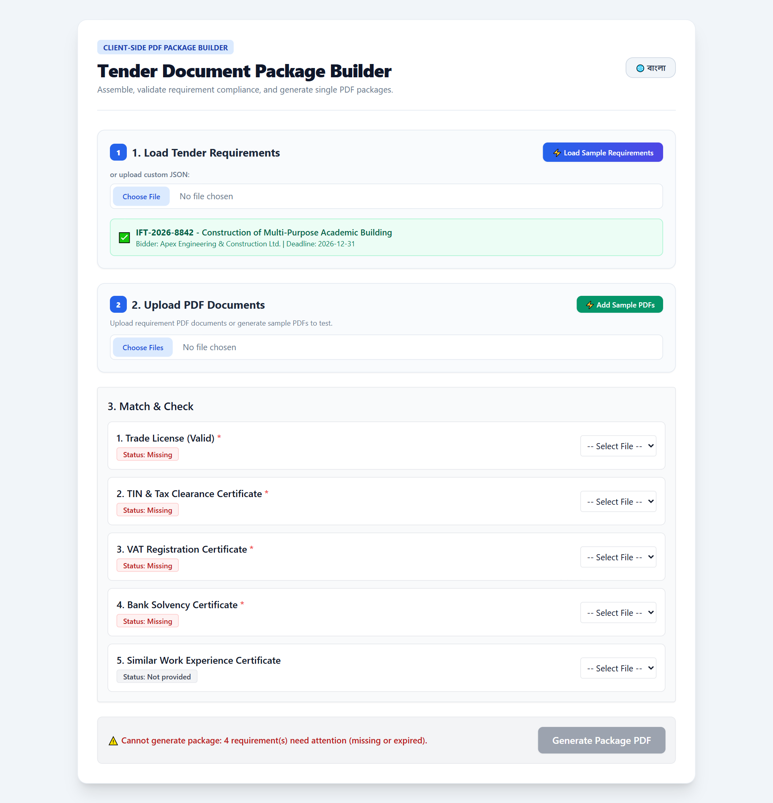
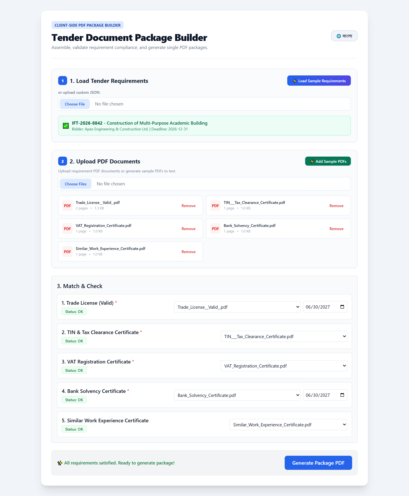
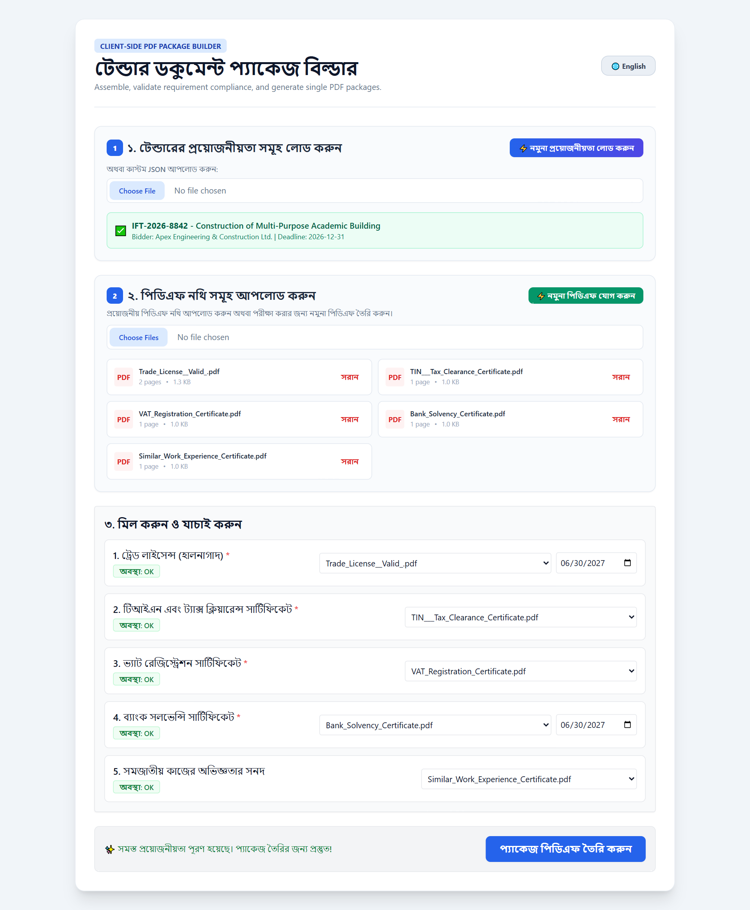

# Tender Document Package Builder

A 100% browser-based client application built with React, Vite, and `pdf-lib` to assemble, validate, and generate compliant tender PDF submission packages.

**Author:** Md Mehrab Hossen — ID: 0242320005101754

## Features
- **Load Requirements**: Parse tender requirements and metadata via JSON.
- **Robust PDF Verification**: Validates files via extension, MIME type, and `%PDF` magic bytes. Detects corrupted files, encryption, and calculates SHA-256 hashes for duplicate identification.
- **Smart Matching & Expiry Management**: Interactively match files to requirements, manage expiry dates against submission deadlines, and monitor real-time requirement statuses (`Missing`, `Expiry date needed`, `Expired`, `Not provided`, `OK`).
- **Compliant PDF Compilation**: Generates a professional PDF package featuring an English cover page, ordered document merging, dynamic page numbering (`<tender_id> | Page X of Y`), and custom footer strips ensuring content never overlaps.
- **Bilingual Interface**: Full toggle between English and Bangla.

## Screenshots

| Load Requirements | Upload & Match |
|-------------------|----------------|
|  |  |

| Ready to Generate | Bangla Interface |
|-------------------|------------------|
|  |  |

> Regenerate these screenshots with `node scripts/capture-screenshots.mjs <baseUrl>` while the app is running (`npm run dev`). The script needs `npm i --no-save playwright-core` and a local Chrome installation.

## Getting Started

1. Install dependencies:
   ```bash
   npm install
   ```
2. Run development server:
   ```bash
   npm run dev
   ```
3. Build for production:
   ```bash
   npm run build
   ```
4. Run unit tests:
   ```bash
   npm run test
   ```

## Project Files — What to Upload to GitHub

When pushing this project to GitHub, upload **only** the following files and folders:

### ✅ Necessary files to upload

| File / Folder | Purpose |
|---------------|---------|
| `src/` | All application source code (components, utils, tests, CSS) |
| `public/` | Static assets served as-is (e.g. `fonts/`) |
| `docs/screenshots/` | UI screenshots embedded in this README |
| `scripts/` | Helper scripts (e.g. screenshot capture) |
| `index.html` | App entry HTML page |
| `package.json` | Lists dependencies and npm scripts |
| `package-lock.json` | Locks exact dependency versions (needed by Vercel) |
| `tailwind.config.js` | Tailwind CSS configuration |
| `postcss.config.js` | PostCSS configuration |
| `README.md` | Project documentation |
| `LICENSE` | MIT License |
| `.gitignore` | Tells Git which files to exclude |

> **Tip:** To upload, run these commands from the project folder — Git will skip the excluded files automatically:
> ```bash
> git init
> git add .
> git commit -m "Initial commit"
> git branch -M main
> git remote add origin https://github.com/<your-username>/tender-package-builder.git
> git push -u origin main
> ```
> Verify what will be committed anytime with `git status` or `git ls-files` — `node_modules` must never appear there.

## Deploying to Vercel

This is a fully static site (no backend required), so it deploys to Vercel as a simple static build.

### Option 1: Via Git (recommended)

1. Push this repository to GitHub/GitLab/Bitbucket.
2. Go to [vercel.com/new](https://vercel.com/new) and import the repository.
3. Vercel auto-detects Vite — confirm these settings:
   - **Framework Preset:** Vite
   - **Build Command:** `npm run build`
   - **Output Directory:** `dist`
   - **Install Command:** `npm install`
4. Click **Deploy**. Every subsequent push to the main branch triggers a new deployment.

### Option 2: Via Vercel CLI

1. Install the CLI and log in:
   ```bash
   npm i -g vercel
   vercel login
   ```
2. Deploy a preview:
   ```bash
   vercel
   ```
3. Deploy to production:
   ```bash
   vercel --prod
   ```

> **Note:** No environment variables or server-side configuration are needed — all PDF processing happens in the browser.

## License

This project is licensed under the MIT License — see the [LICENSE](LICENSE) file for details.

Copyright (c) 2026 Md Mehrab Hossen
